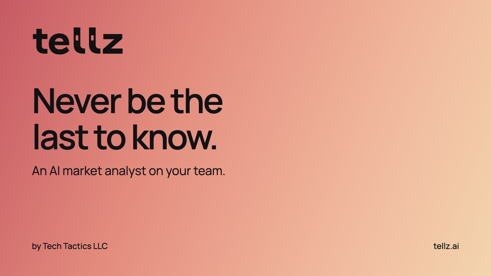

# Tellz by Tech Tactics LLC

An AI market analyst on your team. Read your saved daily competitor brief, open earlier reports and ask what your competitors published, offered or changed. Answers use the dated evidence collected for your Tellz account.

## Connect

MCP server: **https://tellz.ai/mcp**

Add Tellz in Grok Bot, then sign in to your own Tellz account through the browser consent screen. Choose read-only access or allow supported changes. Account credentials and OAuth tokens are never included in this package.

This repository contains a portable Agent Plugins manifest and MCP configuration. The connector runs on Tellz; it does not install a local executable. Public marketplace approval is separate from the existing private connection and shared bot template.

## Try asking

- What did my competitors do in the latest available report?
- Show me the report dates I can read.
- What offers did you collect for a competitor I follow?

Every answer should name its report date, use the saved evidence and retain source links. Missing or untracked information must stay explicit. Supported settings changes require your permission; connecting alone does not create a daily routine in Grok Bot. Confirm any routine and schedule in the assistant.

## Listing identity

- Product: Tellz
- Publisher: Tech Tactics LLC
- Website: https://tellz.ai
- Logo: [512 px original Ember icon](assets/tellz-logo.png)
- Cover: [1600 × 900 branded cover](assets/tellz-cover.png)
- Setup and tools: https://tellz.ai/connect
- Privacy: https://tellz.ai/privacy
- Terms: https://tellz.ai/terms
- Support: hello@tellz.ai / https://tellz.ai/support

The Tellz brand assets are supplied for the official Tellz listing and its promotion. Tellz and its marks belong to Tech Tactics LLC. This repository does not expose product source code, customer records, reviewer credentials or tokens.
